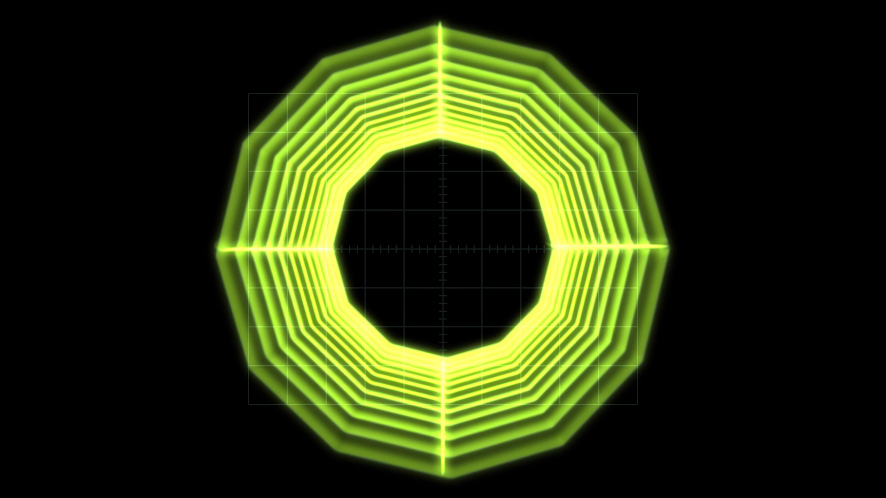

# Vectrix

> **AI-assisted project.** This codebase was created with [Claude](https://claude.com/claude-code)
> (Anthropic), directed and reviewed by a human author. The main claim, that
> brightness follows dwell time, is measured rather than taken on trust: `vxtest --energy`
> renders one sweep at ten speeds spanning a hundred to one and fails if the
> total light deposited varies by more than half a percent, and `vxtest --dwell`
> regresses the measured line density against `1/v`. Both test the same shader
> code that ships. A control sweep fails if any parameter turns out to do
> nothing (see [Building and testing](#building-and-testing)).

An oscillator, a pedalboard and a cathode ray tube in X/Y mode, as two plugins
for Resolume Arena and Avenue.

A function generator makes a two-channel signal. That signal goes through
fourteen guitar and eurorack effects (a gate, a compressor, a wavefolder, a ring
modulator, a phaser, a delay, a spring-ish reverb), and whatever comes out the
far end drives the horizontal and vertical deflection of a scope. So what you're
watching is where the beam went, rather than a picture of an oscilloscope.

It's inspired by [Ms Mad Lemon](https://www.youtube.com/@MsMadLemon)'s *Vector
Synth Visualizer* series, which does the same thing properly, with 555 timers,
LM358 op-amps and the deflection yoke of a CRT television.



<sub>Rendered by the plugin's own offline harness in a headless GL context rather than captured from Resolume: actual frames through the shipped plugin class.</sub>

<!-- downloads:start -->

## Download

**[v0.1.12](https://github.com/stoatworks-labs/vectrix/releases/tag/v0.1.12)** — prebuilt for macOS, Windows and Linux. Pick your platform:

<details>
<summary><b>macOS</b> — Universal (Apple Silicon + Intel)</summary>

| Build | Download | Size |
| --- | --- | --- |
| Universal (Apple Silicon + Intel) · .dmg disk image | [`vectrix-0.1.12-macos-universal.dmg`](https://github.com/stoatworks-labs/vectrix/releases/download/v0.1.12/vectrix-0.1.12-macos-universal.dmg) | 2.1 MB |
| Universal (Apple Silicon + Intel) · .zip archive | [`vectrix-macos-universal.zip`](https://github.com/stoatworks-labs/vectrix/releases/latest/download/vectrix-macos-universal.zip) | 1.9 MB |
| Universal (Apple Silicon + Intel) · .zip archive (OpenFX — Resolve, Vegas, Nuke) | [`vectrix-ofx-macos-universal.zip`](https://github.com/stoatworks-labs/vectrix/releases/latest/download/vectrix-ofx-macos-universal.zip) | 1.2 MB |

</details>

<details>
<summary><b>Windows</b> — x64</summary>

| Build | Download | Size |
| --- | --- | --- |
| x64 · .exe installer | [`vectrix-0.1.12-windows-x86_64-setup.exe`](https://github.com/stoatworks-labs/vectrix/releases/download/v0.1.12/vectrix-0.1.12-windows-x86_64-setup.exe) | 477 KB |
| x64 · .zip archive | [`vectrix-windows-x86_64.zip`](https://github.com/stoatworks-labs/vectrix/releases/latest/download/vectrix-windows-x86_64.zip) | 779 KB |
| x64 · .zip archive (OpenFX — Resolve, Vegas, Nuke) | [`vectrix-ofx-windows-x86_64.zip`](https://github.com/stoatworks-labs/vectrix/releases/latest/download/vectrix-ofx-windows-x86_64.zip) | 426 KB |

</details>

<details>
<summary><b>Linux</b> — x64</summary>

| Build | Download | Size |
| --- | --- | --- |
| x64 · .zip archive (OpenFX — Resolve, Vegas, Nuke) | [`vectrix-ofx-linux-x86_64.zip`](https://github.com/stoatworks-labs/vectrix/releases/latest/download/vectrix-ofx-linux-x86_64.zip) | 1.6 MB |

</details>

All builds, checksums and release notes: [github.com/stoatworks-labs/vectrix/releases](https://github.com/stoatworks-labs/vectrix/releases).

macOS builds are signed and notarised and open normally. The Windows builds are unsigned, so SmartScreen warns once.

<!-- downloads:end -->

## Two plugins

- **Vectrix** (source) — generates its own signal over its own tube.
- **Vectrix Trace** (effect) — paints the clip below **on the tube face**, so it
  curves with the glass, sits behind the graticule and shares the halation. It
  can also take that clip *as* the signal, tracing its edges with the beam.

Both declare the same parameters, so a composition can be moved between them.

## Why brightness follows dwell time

Vectrix models the whole route from signal to glass, and every artefact comes
out of that.

The beam deposits light at a constant rate while it's on. Where it moves fast it
spreads that light over a long distance and the trace is dim; where it turns
around it lingers, and the trace blooms. That one fact is why a square drawn by
an oscilloscope has bright corners and a square drawn by a computer doesn't.

So the renderer never computes `1/v`. It deposits a fixed quantum of energy per
sample interval and spreads it over the distance the beam actually covered, and
the `1/v` falls out of that, along with the right behaviour at both extremes and
no clamps: a beam crossing the screen in one step is faint, and a beam standing
still is bright but finite, because the energy is conserved either way.

Everything else follows the same rule. The delay's repeats get rounder because
its feedback path is low-passed and a low-passed deflection signal has softer
corners. The gate darkens the trace without moving it, because a grid voltage
cuts beam current without touching the yoke. Sample & Hold draws lines between
its steps because the beam travels rather than teleporting. Turn on **Blank on
Retrace** with two sawtooths and you get a clean raster, because the beam is
actually cut off during flyback. Nothing is skipping the flyback line.

## Sources

- **Oscillator** — sine, triangle, saw, ramp, pulse, noise and sample & hold per
  axis, with the X:Y ratio locked to exact rationals so a Lissajous figure stands
  still. Detune is a separate control, for when you want the drift.
- **Shape** — circle, square, diamond, polygon, star, rose, spirograph.
- **Wireframe** — a spinning cube, a globe, a tunnel, and a scrolling
  three-dimensional landscape with hidden-line removal.
- **Audio file** — WAV, AIFF, MP3, FLAC, Ogg and Opus. Left drives X, right
  drives Y. This is how [oscilloscope music](https://oscilloscopemusic.com) works,
  and vectrix plays it. Mono files get a delayed-self plot rather than a flat
  line.
- **Trace** (effect only) — finds the edges of the clip below and walks them with
  the beam. **Expect it to be excellent on titles, logos, graphics and line art,
  and a scribble on real footage.** That's down to the problem itself, and
  there isn't a setting that fixes it.

## Effects

In a fixed pedalboard order, because fourteen blocks is fourteen factorial
orderings and "what order are my pedals in" is the first thing anyone gets wrong:

```
VCA → Gate → Compressor → Rectifier → Slew → Drive/Fold → Ring Mod → Bitcrush
    → Phaser → Flanger → Chorus → Delay → Reverb → Deflection Amp
```

Each can process both axes, one axis, or the mid/side pair, and that routing
control is where most of the pictures come from: an effect applied to one
deflection axis and not the other stops being a filter and becomes a geometric
transform.

Three worth calling out:

- **Phaser** is the one that justifies doing any of this on the CPU. On X only it
  shifts each frequency component of the horizontal deflection by a different
  amount, so a sine figure *rotates* and a complex one *shears*. That isn't an
  affine transform, so no shader can produce it. At Mix 1.0 there are no notches
  at all and it becomes a pure rotator.
- **Compressor** pumps the figure's *size*. It's the single best block for
  making a static figure feel alive, and it's what makes the audio-file source
  usable, since scope music has wildly varying level. Its limiter offers **Gain**
  (the figure shrinks) or **Rail** (the figure flattens against the edge of the
  screen, the way a deflection amplifier does when it runs out of headroom).
- **Slew limiter** rounds every corner, and turns Sample & Hold from a
  constellation into a constellation with strings.

## The tube

The phosphors come from a table of measured data rather than a tint. **P31** is
the modern scope green, and at true persistence it shows no trail at all at
60 fps, because that's what P31 *is* (and why nobody photographs slow sweeps on
one). **P7** is the
two-layer cascade: a blue flash that pumps a yellow-green layer underneath, so
the trail is a different colour from the strike. Switching phosphor changes the
brightness by up to three times, because the efficiencies are real.

Face Aspect, Corner Radius and Deflection Gain span both references without a
second renderer: the defaults are a round lab scope, and 4:3 with a small corner
radius and a little overscan gives you the consumer television from the videos.

The face buffer is sized by the **spot**, not by the output, so 4K costs about
two and a half times 1080p rather than four. What actually drives the cost is
Focus: a sharper tube resolves more, and costs more for it.

## Controls

About a hundred and fifty of them, in sixteen groups. That's a lot, I know, but
the effect parameters *are* the plugin, so cutting them wouldn't help. Start
from a **preset** (each one is a whole machine rather than a set of slider
positions, so turning one knob on it does something you can predict) and go from
there.

## Watch it

[**Vectrix — an oscillator, a pedalboard and an oscilloscope**](https://www.youtube.com/watch?v=CmmhEgHyGzg)
(55 seconds). It's all the plugin's own output. An FFGL plugin doesn't have a
window to film, so the footage comes from the plugin's offline harness, running
the same class Resolume loads, rather than a screen recording.

## Trying it

A browser demo runs at
[vectrix-demo.stoatworks-labs.com](https://vectrix-demo.stoatworks-labs.com).
Nothing you load there leaves your machine.

It carries the **whole renderer** (the same nine shader sources, checked
character for character against the plugin's by `demo/tools/check_shaders.py`)
and a **subset** of the signal chain: the oscillator and the shapes, plus the
rectifier, slew limiter, wavefolder, ring modulator, bitcrusher, phaser and
delay. The wireframe, audio-file and trace sources and the remaining effects
aren't in it, and the page says so too.

## Build

```bash
git clone --recursive https://github.com/stoatworks-labs/vectrix
cd vectrix
cmake -B build -DCMAKE_BUILD_TYPE=Release
cmake --build build
cmake --install build      # into ~/Documents/Resolume Arena/Extra Effects
```

The Opus decoder builds libogg, libopus and libopusfile from source as
submodules, which keeps the universal macOS binary working. A vcpkg port
couldn't, because vcpkg triplets are per-architecture. Configure with
`-DVECTRIX_WITH_OPUS=OFF` to drop `.opus` support and those three submodules.

## Building and testing

```bash
tools/verify.sh              # everything
./build/vxtest --energy      # brightness is independent of beam speed
./build/vxtest --dwell       # measured density against 1/v
python3 tools/sweep.py       # no dead controls
```

## Status

See the "what is genuinely verified, and what is assumed" section of
[AGENTS.md](AGENTS.md), which is blunt about it. The short version: the physics
is measured by the harness, and both plugins have been **loaded and run in
Resolume Arena**. What's still unconfirmed is narrower: whether Arena's input
is actually premultiplied, and how the Trace source's readback behaves for
frame rate in a real host.

## OpenFX — Resolve, Vegas, Nuke, Natron

The same code builds an OpenFX bundle carrying both plugins. Copy
`build/Vectrix.ofx.bundle` to `/Library/OFX/Plugins` (macOS),
`C:\Program Files\Common Files\OFX\Plugins` (Windows) or `/usr/OFX/Plugins`
(Linux).

**v0.1.6 to v0.1.11 crashed on every render.** In those releases the OpenFX
build segfaulted the moment a host asked either plugin for a frame, in every
host: a table of parameter declarations kept in panel order was being looked up
by id. **v0.1.12 fixes it. If you tried Vectrix in Resolve or another OpenFX
host and it crashed or never rendered, update.** The Resolume build was never
affected. From v0.1.12 both plugins render as tools on Resolve's Fusion page
(DaVinci Resolve Studio 21.1 on macOS, 2026-10-04). I haven't tried Resolve's
other pages, Vegas, Nuke or Natron.

> **On Linux the plugin needs `libGL`, and nothing else unusual.** The Trace
> source is a GPU edge trace, so unlike every other plugin in this fleet the
> Vectrix `.ofx` links OpenGL (its siblings only need libc, libm and libpthread).
> GLEW is linked statically into the binary, so the only thing the machine has to
> supply is `libGL.so.1`, which is present on anything capable of running Resolve
> and comes from the base repository on Rocky 8 / RHEL 8 (`mesa-libGL`).
>
> **If you're on v0.1.3, this isn't true of your build yet.** That release
> shipped a `.ofx` that needs `libGLEW.so.2.0` on the machine, which on Rocky 8
> means enabling PowerTools and installing `glew-devel`. Its release notes carry
> the commands. Upgrading is the easier fix.
>
> Either way the failure mode is worth knowing, because it's silent: **an OFX
> host doesn't report a plugin that failed to load.** Resolve just starts with
> no Vectrix in the effects list and nothing in any log, which looks like a broken
> download rather than a missing library. That's why CI now runs its load test
> on a stock Rocky 8 with no GL libraries beyond `mesa-libGL`, so a pass says
> something about a real machine rather than about a container set up to make
> it pass.

The signal chain is the same code (the engine is linked in, not reimplemented),
but five things differ, and they're limitations rather than choices:

- **It renders on the CPU.** OpenFX hands a plugin no GL context, so the beam,
  the phosphor and the glass are a mirror of the GLSL rather than the GLSL. It's
  offline-render speed, not interactive.
- **It replays.** Vectrix is stateful (phosphor, delay lines, a reverb tank),
  and OpenFX renders frames in whatever order it fancies. So a seek, a jump or a
  parameter edit restarts the chain and warms it up over 120 frames. A linear
  render is exact; a reverb tail longer than that window isn't.
- **No tempo and no audio.** OpenFX has neither, so the tempo is pinned at 120
  and the spectrum reads as silence. The LFOs still run, since they need only a
  frame duration, so the modulation slots are live.
- **The Trace source draws no beam**, because its edge pass needs a GPU. You get
  the tube, the graticule and the clip on the glass, with the gun cut off.
- **Resolve's Fusion page reports the frame rate on the effect but not on its
  clips.** The first OpenFX builds read a clip's rate, which Fusion leaves out,
  and failed every render there. Now Vectrix asks the output clip, the source clip
  and then the effect, so in Fusion the oscillator, the LFOs and the replay run at
  the timeline's own rate (checked at 24 and 25 fps). It assumes 24 fps, Resolve's
  default timeline rate, only where a host reports no rate at all.

## Diagnostics

`source/Diag.{h,cpp}` writes a log file and nothing else: no crash handler, since
this runs inside someone else's host. It's there for the one failure that actually
happens: a shader that won't compile, which otherwise looks like "the effect
does nothing" with no message anywhere. `~/Library/Logs/vectrix/` on macOS.

<!-- attributions:start -->
This project is built on other people's work — see [ATTRIBUTIONS.md](ATTRIBUTIONS.md).
<!-- attributions:end -->

## Licence

MIT. See [LICENSE](LICENSE) and [ATTRIBUTIONS.md](ATTRIBUTIONS.md).
